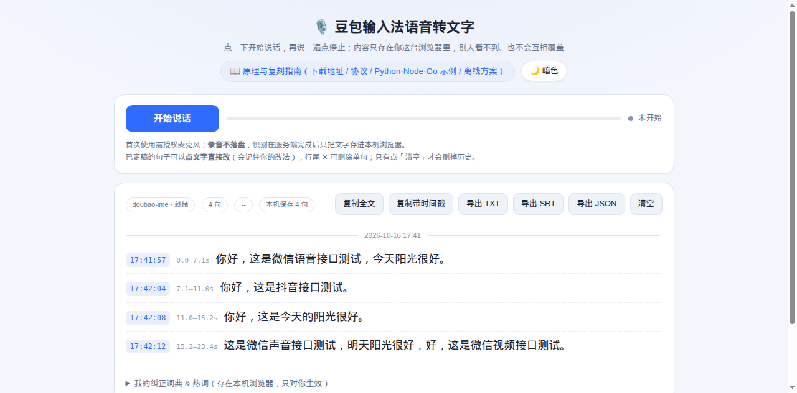

# Doubao IME speech-to-text — web demo

> Open a web page, hit record, get live transcription with per-sentence timestamps.
> All user data stays in the browser (`localStorage`).

This is an open-source re-implementation of the speech-recognition channel that the
**Doubao input method (PC)** uses for its own voice typing: the browser captures audio,
a thin server relays it to ByteDance's streaming ASR endpoint, and text comes back
sentence by sentence. **No login, no API key, no paid API.**

中文说明见 [README.md](README.md)；完整原理（下载地址 / 包结构 / 协议表 / 三语言示例）见
`/how` 页面（源码：`templates/how.html`）。

> ⚠️ **Disclaimer**: this talks to an *undocumented internal* endpoint of the Doubao input method.
> For study and personal use only. It may break or be rate-limited at any time. For products,
> use the official [Volcengine ASR](https://www.volcengine.com/product/asr) or a local model
> (FunASR / sherpa-onnx / whisper.cpp).

> 🔗 **Live demo (nothing to install)**: <https://doubao.hsfp.cn/> — your data still stays in your
> own browser. It is a self-hosted instance run by the author, so it may be rate-limited or offline
> at times; for regular use, self-host it via [Quick start](#quick-start).



## Quick start

```bash
git clone https://github.com/glwhappen/doubao-asr-web.git
cd doubao-asr-web
python3 -m venv venv && ./venv/bin/pip install -r requirements.txt
./venv/bin/python -m uvicorn server:app --host 127.0.0.1 --port 4416
```

Open <http://127.0.0.1:4416>, click **开始说话** (start), allow the microphone.
Credentials are obtained anonymously on first use and cached in `.creds.json`.

Headless self-test (no browser, no mic):

```bash
./venv/bin/python test_client.py tests/fixture-6s.wav 127.0.0.1 4416
```

## How it works

```
browser (AudioWorklet, 16k mono PCM16, 20 ms frames)
   │  WebSocket /ws
   ▼
your server  ──① device_register (log.snssdk.com) ─▶ device_id
             ──② settings/v3 (is.snssdk.com)       ─▶ asr_config.app_key
             ──③ protobuf over WebSocket           ─▶ frontier-audio-ime-ws.doubao.com
                  StartTask → StartSession → TaskRequest×N → FinishSession
   ▲  {"type":"update"/"final"} — cumulative text + per-character timing
```

- Credentials are **app + device level** (anonymous device registration), which is why no account is needed.
- Upstream protobuf fields: `2=token`, `3=service`, `5=method`, `6=payload`, `7=audio`, `8=request_id`, `9=frame_state` (1 first / 3 middle / 9 last).
- Audio can be sent as raw `16 kHz PCM16` (`audio_info.format = "raw"`), no Opus encoder needed.
- The upstream randomly returns `50700000 service discovery failure` (~1 in 5 in our tests); the server retries, replays buffered audio, then falls back to a local engine.
- There is **no `language` field**: the model is Chinese + English only (mixed input). Japanese is decoded as Chinese gibberish.

## Languages

Chinese ✅ · English ✅ · mixed zh/en ✅ · Japanese/others ❌

## Privacy

Transcripts and the correction lexicon live in `localStorage` (`doubao-asr-transcript`,
`doubao-asr-lexicon`). The lexicon is sent to the server once per session, used only
inside that session (text replacement + hotwords), then discarded — so multiple users
sharing one deployment never overwrite each other. The only server-side file is
`.creds.json` (device id + token, mode 0600, git-ignored).

## Clients / integration

`examples/asr_min.{py,js,go}` are complete single-file clients (register device → fetch key →
WebSocket → print text) with retry built in. See the `/how` page for the full protocol table.

A browser **cannot** talk to the upstream directly: it requires custom WebSocket handshake
headers (`proto-version: v2`), which browsers cannot set. That is why a small server is required.

## Offline

Doubao's own on-device model cannot be reused (private per-tensor format, statically linked
Flute engine, authenticated model download — and the Windows 0.9.2.7 build does not even ship it).
Use FunASR / sherpa-onnx / whisper.cpp instead; `engine=local` in this project already
integrates a local FunASR engine as a fallback.

## License

[MIT](LICENSE)
