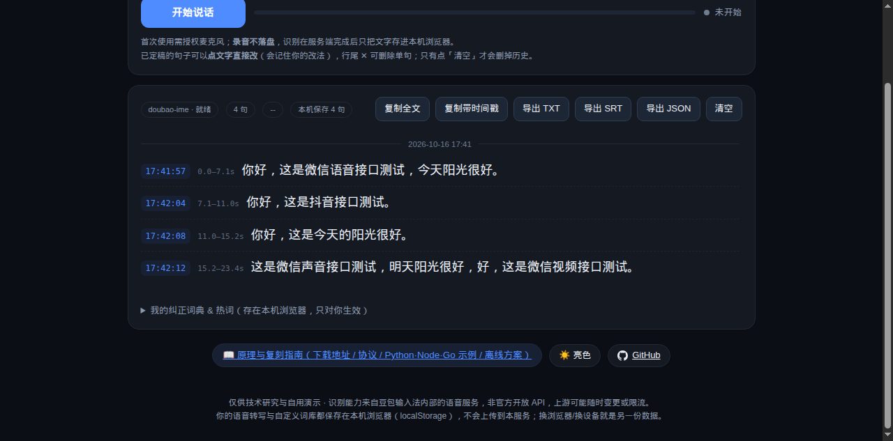
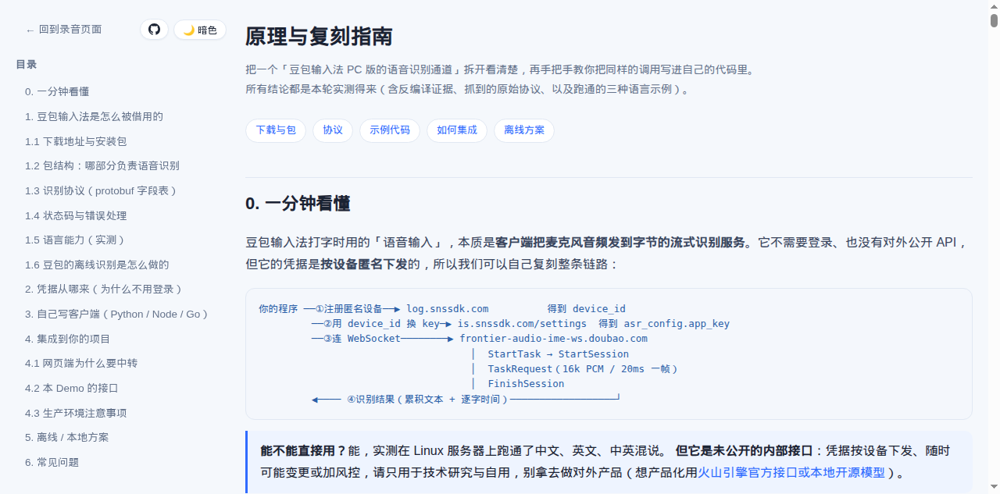

# 豆包输入法语音转文字（Web Demo）

> 打开网页就能录音、实时转成文字，带时间戳、可导出字幕；**数据只存在你自己的浏览器里**。

用豆包输入法（PC 版）自己的语音识别通道做的开源复刻：浏览器采集麦克风 → 自建服务端 → 字节的流式识别服务
→ 逐句回传带时间戳的文本。**不需要登录、不需要任何账号**，也不依赖 OpenAI 之类的付费 API。

- 🎙️ **实时转写**：边说边出字，按句定稿
- ⏱️ **逐句时间戳**：墙钟时间 + 音频偏移（`0.0–3.4s`），能导出 SRT 字幕
- ✏️ **会学你的纠正**：点句子直接改，改法记住并影响后续识别
- 🔒 **数据不出本机浏览器**：转写与词库都存 `localStorage`，多人共用一份部署也互不覆盖
- 🧩 **可集成**：服务端是标准 WebSocket，附 Python / Node / Go 三份最小客户端
- 🗣️ **说话人分离 + 声纹库**（可选）：多人对话时**边录边给每句标「谁说的」**；
  注册过声音的人以后**自动认出来并用真名标注**（跨录音有效，声纹只存本机）
- 🌗 **亮/暗主题**、🛟 **离线兜底**（云端不可用时自动切本地 FunASR）

> ⚠️ **先看免责声明**：本项目调用的是豆包输入法客户端内部的**未公开接口**，仅供技术研究与个人自用。
> 接口随时可能变更、可能触发风控。要用于产品或商用，请走 [火山引擎官方语音接口](https://www.volcengine.com/product/asr)
> 或本地开源模型（见下文"离线方案"）。

---

## 快速开始

需要 Python 3.11+ 和一个能录音的浏览器（`getUserMedia` 只在 HTTPS 或 localhost 下可用）。

```bash
git clone https://github.com/glwhappen/doubao-asr-web.git
cd doubao-asr-web
python3 -m venv venv && ./venv/bin/pip install -r requirements.txt

# 本机跑（默认 http://127.0.0.1:4416，localhost 属于安全上下文，可以直接用麦克风）
./venv/bin/python -m uvicorn server:app --host 127.0.0.1 --port 4416
```

打开 <http://127.0.0.1:4416>，点「开始说话」，允许麦克风即可。

不需要任何 API Key —— 服务端会在第一次转写时**匿名注册一台设备**并换取识别凭据（缓存到 `.creds.json`，12 小时刷新）。

### 命令行自测（不用浏览器、不用麦克风）

```bash
# 把一段 wav 当麦克风推给服务端，验证整条链路
./venv/bin/python test_client.py tests/fixture-6s.wav 127.0.0.1 4416
# → 最终: "你好，这是微信语音接口测试，今天阳光很好。"
```

<details open>
<summary>截图</summary>

亮色（默认）：


暗色：



原理页（`/how`，含协议表与三语言示例）：



界面结构：

```
┌──────────────────────────────────────────────────────────┐
│        🎙️ 豆包输入法语音转文字                            │
│   内容只存在你这台浏览器里，别人看不到、也不会互相覆盖      │
│   [📖 原理与复刻指南] [🌙 暗色] [ GitHub ]                │
│ ┌──────────────────────────────────────────────────────┐ │
│ │ [开始说话]  ▂▃▅▂▁            ● 识别中…               │ │
│ └──────────────────────────────────────────────────────┘ │
│ ┌──────────────────────────────────────────────────────┐ │
│ │ doubao-ime · 就绪  4 句  本机保存 4 句                │ │
│ │            [复制全文][复制带时间戳][TXT][SRT][JSON][清空]│
│ │ ─────────────── 2026-10-16 17:41 ───────────────────  │ │
│ │ 17:41:57  0.0–7.1s   你好，这是微信语音接口测试…      │ │
│ │ 17:42:04  7.1–11.0s  你好，这是抖音接口测试。      ✕  │ │
│ └──────────────────────────────────────────────────────┘ │
└──────────────────────────────────────────────────────────┘
```

</details>

---

## 它是怎么工作的

```
浏览器                                    你的服务端                     字节识别服务
──────                                    ──────────                     ────────────
AudioWorklet 采集 16k/mono/PCM16
   │ 20ms 一帧（640B）二进制
   └─────────── WebSocket /ws ─────────▶ ① 匿名注册设备（log.snssdk.com）  → device_id
                                         ② 换识别凭据（is.snssdk.com）     → asr_config.app_key
       {"type":"config","lexicon":…} ──▶ （本次会话的词库，用完即弃）
                                         ③ 转成上游 protobuf 帧
                                            StartTask → StartSession
                                            TaskRequest × N → FinishSession ─▶ frontier-audio-ime
       ◀──── {"type":"update"/"final"} ──  ④ 累积文本 + 逐字时间             ◀── 识别结果
```

关键点（都是实测得来，完整推导见 **[`/how` 原理页](templates/how.html)** 与 [`docs/`](docs/)）：

- **凭据是"应用 + 设备"级**：客户端内置 `aid`，用匿名设备注册接口换 `device_id`，再用它换 `app_key`。
  没有账号体系参与，所以不用登录。
- **上游是 WebSocket + protobuf**：字段号 `2=token`、`3=service`、`5=method`、`6=payload`、`7=audio`、`8=request_id`、`9=frame_state(1首/3中/9末)`。
- **音频可以直接送 16k PCM**（`audio_info.format = "raw"`），不必自己实现 Opus。
- 上游偶发 `50700000 service discovery failure`（实测约 1/5 概率），代码里做了重连补喂 + 降级。
- 上游**没有 language 字段**：模型是 zh + en 双语（中英混输），日语等其它语种会输出中文乱码。

---

## 支持的语言

| 输入 | 结果 |
|---|---|
| 普通话 | ✅ |
| 英语 | ✅（标点、大小写都对） |
| 中文 + 英文混说 | ✅（官方宣传的"中英混输"） |
| 日语 / 韩语 / … | ❌ 会被强行按中文解码（`こんにちは` → 「国内计划。」） |

想要多语种：接官方多语种接口，或在本项目里挂本地模型（见下面的"离线方案"）。

---

## 数据与隐私

**所有用户数据都在浏览器本地，服务端不保存任何转写内容或词库。**

| 数据 | 位置 | 行为 |
|---|---|---|
| 转写内容（含时间戳） | `localStorage['doubao-asr-transcript']` | 每次识别追加，插入每次录音的时间分隔线；只有点「清空」才删 |
| 声纹库 | `localStorage['doubao-asr-voiceprints']` | 已注册的说话人姓名 + 512 维声纹；用于跨录音自动认人 |
| 纠正词典 + 热词 | `localStorage['doubao-asr-lexicon']` | 点句子改字即学会；面板可删单条/清空 |
| 主题偏好 | `localStorage['doubao-asr-theme']` | 亮 / 暗 |

多人共用同一份部署时：每个人的词库会在**会话开始时**通过 WebSocket 发给服务端，服务端只在这次会话里用
（做文本替换 + 当热词带给识别服务），用完即弃 —— 所以 A 的词库和记录不会影响 B。

服务端唯一的落地文件是 `.creds.json`（设备 id + 识别凭据，`0600` 权限），已被 `.gitignore` 排除。

---

## 配置

环境变量（也可以写进项目根的 `.env`，用 systemd 的 `EnvironmentFile` 加载）：

| 变量 | 默认 | 说明 |
|---|---|---|
| `DOUBAO_MAX_SESSIONS` | `3` | 并发会话上限（所有用户共享同一个 `app_key` 配额） |
| `DOUBAO_CLOUD_RETRY` | `2` | 云端会话中途失败的重连次数（会补喂已说过的音频） |
| `DOUBAO_CONTEXT` | `1` | 是否把热词上下文带给上游 |
| `DOUBAO_CLOUD_WS` | 官方地址 | 上游 WebSocket 地址（换代理/自建网关时用） |
| `DOUBAO_GITHUB_URL` | 本项目地址 | 页面上 GitHub 图标指向的仓库 |
| `DOUBAO_CREDS` | `.creds.json` | 设备凭据缓存位置 |
| `DOUBAO_LOCAL_ENGINE` + `DOUBAO_LOCAL_ENGINE_TOKEN` | 空 | 本地兜底引擎（FunASR `asr-engine`）；配了才会启用降级 |
| `DOUBAO_LOG_LEVEL` / `DOUBAO_DEBUG_WIRE` | `INFO` / `0` | 日志级别 / dump 上游字节（排查用） |
| `DOUBAO_DIAR_DIR` | `./models` | 说话人分离模型目录 |
| `DOUBAO_DIAR_MODE` | `online` | `online` 边录边标 / `batch` 收尾整段算 / `both` 两者 |
| `DOUBAO_DIAR_THRESHOLD` | `0.7` | 整段聚类阈值（越小越容易并成一个人） |
| `DOUBAO_DIAR_ONLINE_THRESHOLD` | `0.4` | 在线追踪的余弦阈值 |
| `DOUBAO_DIAR_ONLINE_MIN` | `0.6` | 短于这个秒数的句子不做声纹，继承上一位 |
| `DOUBAO_DIAR_GALLERY_THRESHOLD` | `0.45` | 与声纹库比对时的余弦阈值（比会话内聚类更严） |
| `DOUBAO_DIAR_MIN_ON` / `MIN_OFF` | `0.3` / `0.5` | 分割片段的最短/最短间隔 |
| `DOUBAO_DIAR_MAX_SECONDS` | `600` | 超过这个时长就跳过分离，防卡死 |

---

## 接口

| 接口 | 说明 |
|---|---|
| `GET /` | 录音页面 |
| `GET /how` | 原理与复刻指南（公式：下载地址、包结构、协议表、三语言示例、集成方式、离线方案） |
| `WS /ws?engine=auto\|cloud\|local` | 转写会话；`auto` = 云端优先，失败自动降级本地引擎 |
| `GET /health` | 状态、并发、上游凭据是否就绪 |

### WebSocket 协议

```jsonc
// 客户端 → 服务端
二进制帧             16k 单声道 PCM16（怎么切都行，服务端会攒成 20ms 帧）
{"type":"config","lexicon":{"corrections":[{"wrong":"接口测试","right":"接口验证"}],"hotwords":["专有名词"]},
 "diarize":true}     // diarize=true 时收尾会做说话人分离
{"type":"stop"}      说完了，收尾并返回最终结果
{"type":"cancel"}    丢弃本次会话

// 服务端 → 客户端
{"type":"status","engine":"cloud|local","message":"…"}
{"type":"update","engine":"cloud","lines":[…],"text":"…"}   // 实时结果，每次给全量
{"type":"final","engine":"cloud","lines":[…],"text":"…","speakers":2,"error":null}   // lines 里可能有 spk
{"type":"error","message":"…"}

// lines 的每一项
{"text":"你好。","start":0.0,"end":1.3,"ts":1792130303000,"final":true,"spk":2,
 "orig":"你号。","fixes":[["你号。","你好。"]]}   // orig/fixes/spk 都是可选的
```

---

## 直接调用上游（不做网页，只要识别）

`examples/` 里有三份**完整可运行**的单文件客户端：自己注册设备、拿凭据、跑完一次识别并打印文本，
内置了 `50700000` 重试。协议细节见 [`/how`](templates/how.html) 或 [`docs/`](docs/)。

```bash
# Python
pip install websockets && python examples/asr_min.py test.wav

# Node（上游靠握手头 proto-version 选择二进制 protobuf，Node 内置 WebSocket 设不了自定义头，所以用 ws）
npm i ws && node examples/asr_min.js test.wav

# Go
cd examples && go mod tidy && go run asr_min.go test.wav
```

三份都实测跑通（中文 + 英文）。要点：

1. `POST https://log.snssdk.com/service/2/device_register/` 匿名注册设备 → `device_id`
2. `POST https://is.snssdk.com/service/settings/v3/` → `data.settings.asr_config.app_key`
3. 连 `wss://frontier-audio-ime-ws.doubao.com/ocean/api/v1/ws?aid=685343&device_id=<did>`，
   握手头带 `proto-version: v2`、`x-custom-keepalive: true`
4. `StartTask → StartSession → TaskRequest×N（20ms/帧）→ FinishSession`

> 浏览器**不能**直连上游：上游需要自定义握手头，而浏览器的 `WebSocket` 不允许设置请求头。
> 这就是本项目必须有一个（很薄的）服务端的原因。

---

## 部署

单进程、无数据库。生产建议 systemd + Nginx/Caddy 反代（WebSocket 必须走 https/wss）：

```ini
# /etc/systemd/system/doubao-asr-web.service
[Unit]
Description=Doubao IME ASR web demo
After=network-online.target

[Service]
WorkingDirectory=/opt/doubao-asr-web
EnvironmentFile=-/opt/doubao-asr-web/.env
ExecStart=/opt/doubao-asr-web/venv/bin/python -m uvicorn server:app --host 127.0.0.1 --port 4416
Restart=always

[Install]
WantedBy=multi-user.target
```

反代只要两条：`/` → `127.0.0.1:4416`（升级 WebSocket 的 `Upgrade`/`Connection` 头要放行）、HTTPS 证书。

---

## 说话人分离（可选）

上游 ASR **不支持**说话人分离（结果里没有 speaker 字段），所以这一步在我们这边做。

**默认是"边录边标"**（`DOUBAO_DIAR_MODE=online`）：每句一定稿，就从这一段音频里提一次声纹
（3D-Speaker，约 50ms），和已有说话人的中心向量比余弦相似度 —— 够像就归他，否则新建一位。
所以标签是**实时出现**的，不用等录音结束。

方案和 [screenpipe](https://github.com/screenpipe/screenpipe) 一致 ——
**pyannote 分割模型 + 3D-Speaker 声纹 + 聚类**（sherpa-onnx 的 `OfflineSpeakerDiarization`，同一套配方）：

```bash
# 1) 装依赖（只有做分离才需要，基础功能不依赖它）
./venv/bin/pip install -r requirements-diarization.txt

# 2) 下模型（约 45MB，走 hf-mirror 镜像；GitHub releases 在国内常被墙）
./tools/fetch_diarization_models.sh          # → ./models/{segmentation,embedding}.onnx
```

页面上勾选「**区分说话人**」即可（偏好存在本机）。说完一句、那句话定稿后，
前面就会出现「说话人 1 / 说话人 2」彩色标签；**点标签可以改名**（比如改成「李总」），
改名后导出的 TXT/SRT/JSON 里也用这个名字。

实测数据（32 核 CPU，单进程）：

| 项 | 值 |
|---|---|
| 速度（online，默认） | 每句约 50ms，实时出标签，停止时不用等 |
| 速度（batch 整段模式） | 19.3s 音频约 8s（≈2.4× 实时），停止时才出标签 |
| 模型 | pyannote segmentation-3.0（6 MB）+ 3D-Speaker ERes2Net（38 MB） |
| 效果 | 中文女声 + 英文男声混在一起 → 正确分成 2 人；单人录音 → 只有 1 人 |
| 阈值 | 整段聚类 `DOUBAO_DIAR_THRESHOLD` 默认 **0.7**；在线追踪 `DOUBAO_DIAR_ONLINE_THRESHOLD` 默认 **0.4**（实测同人 0.36~0.79、不同人 ≈ -0.09） |

**局限（先说清楚）**：不做重叠语音（两人同时说话归给其中一人）；在线追踪是"逐句独立判断"，
所以说话人编号只在这一次录音内有意义，跨录音不会自动认出「还是刚才那个人」
（要做声纹库得自己把 embedding 存下来比对）；太短的句子（<0.6s）算不出可靠声纹，会继承上一位说话人。

想换成"录完整段再算"（更准、但要等）：`DOUBAO_DIAR_MODE=batch`；
`both` = 先实时出、收尾再用整段结果校正。

关掉它：页面取消勾选，或服务端不装模型（`/health` 会报 `diarization.available=false`，页面上该选项自动禁用）。

## 离线方案

豆包自己的端侧离线识别**拿不过来**（模型是私有逐张量格式、推理引擎 Flute 静态编译进客户端、模型包要鉴权下载；
而且 Windows 版 0.9.2.7 里根本没有这套东西）。想要"断网也能用"，用开源等价物：

| 方案 | 特点 |
|---|---|
| **FunASR** | 中文好、带标点/VAD，CPU 约 1.5–2 倍实时；本项目的 `engine=local` 就是接它（`/stream` 流式接口） |
| **sherpa-onnx** | 纯 ONNX 运行时，模型小、多语种（含日语）、跨平台 |
| **whisper.cpp / faster-whisper** | 多语种最强，代价是模型大、CPU 慢 |

本项目已内置降级逻辑：云端握手失败 / 会话中断 / 重连失败 → 自动切本地引擎继续转写（页面会提示）。

---

## 开发

```bash
# 单元测试（不联网：分段、合并、词库替换、说话人贴标签）
./venv/bin/python -m unittest discover -s tests -p "test_*.py" -v

# 端到端验证（需要服务在跑）
./venv/bin/python tests/verify_session_lexicon.py    # 词库只对本次会话生效
./venv/bin/python tests/verify_diarization.py        # 两段不同人的音频 → 标签不同
./venv/bin/python tests/verify_voiceprint.py         # 注册声纹 → 下次自动认出这个人

# 改完示例代码后重新生成原理页
./venv/bin/python tools/build_how_page.py
```

目录结构：

```
server.py                  FastAPI：凭据、上游 protobuf 会话、本地兜底、/ws
diarization.py             说话人分离（sherpa-onnx：pyannote 分割 + 3D-Speaker 声纹 + 聚类）
tools/fetch_diarization_models.sh  下载分离模型
static/index.html          录音页面（前端逻辑全在这里）
static/worklet.js          AudioWorklet：任意采样率 → 16k PCM16
static/theme.js            亮/暗主题切换
static/how.html            原理页（由 templates/ + examples/ 生成）
templates/how.html         原理页模板
tools/build_how_page.py    生成原理页
examples/asr_min.{py,js,go} 三份最小客户端
tests/                     单元测试 + 端到端脚本
docs/                      逆向分析记录（协议、包结构、踩坑）
```

---

## 免责声明

- 本项目与字节跳动、豆包输入法没有任何隶属关系，也不包含任何微信/豆包的程序文件或用户数据。
- 调用的接口来自对**公开安装包**的分析，属于未公开的内部接口；请只用于学习和个人自用，
  不要用于对外商业产品，也不要用它绕过任何付费或风控机制。
- 上游随时可能改协议、限流或封禁；因此产生的任何后果由使用者自行承担。
- 代码以 MIT 许可发布；第三方接口、商标归各自所有者。

## 致谢

- 协议字段的早期公开参考：[`WEIFENG2333/voxgate`](https://github.com/WEIFENG2333/voxgate)（Go，MIT）
- 中文离线兜底：[FunASR](https://github.com/modelscope/FunASR) / [sherpa-onnx](https://github.com/k2-fsa/sherpa-onnx)
- 测试语音 fixtures 来自 MIT 许可的合成语音，不含真人录音

## License

[MIT](LICENSE)
